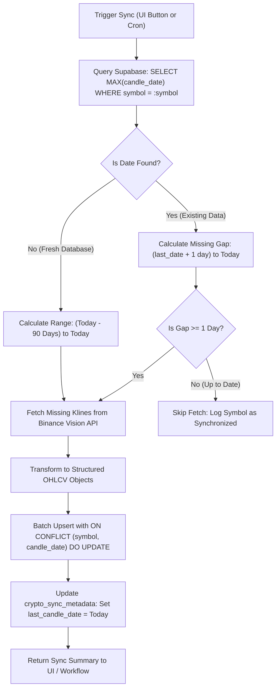

# Strategic Architectural Blueprint: Supabase Crypto Smart-Sync & Backfill Engine

**Document Status**: Proposed Architecture  
**Target Storage**: Supabase Free Tier (PostgreSQL)  
**Cost Model**: 100% Free ($0 / Month)  
**Primary Constraints**: Turso DB Preserved & Untouched, Render Free Tier Compatibility, Idempotent Backfilling  

---

## 1. Executive Summary & Core Constraints

### The Challenge
Our application is currently deployed on **Render's Free Tier** (ephemeral containers, 512MB RAM, 15-minute idle spin-down). The existing **Turso SQLite database** is actively written to by another application and contains irreplaceable historical data for **Nifty Indices and Weather modules**. 

Any schema modification, table drop, or high-volume write strain on Turso would risk corrupting or wiping existing Nifty/Weather datasets. Additionally, cryptocurrency markets produce high-velocity real-time tick events that would rapidly overwhelm free-tier storage if written to a database continuously.

### The Strategic Solution: Decoupled Dual-Database Architecture
```
                                 ┌────────────────────────────────────────────────────────┐
                                 │                   USER'S BROWSER                       │
                                 │                                                        │
                                 │  • Vue 3 / Nuxt 3 Client Dashboard                     │
                                 │  • In-Memory WebSocket (wss://stream.binance.com)     │
                                 │  • Client-Side Direct Failover                         │
                                 │  • UI "Sync Data" Button & Status Badge               │
                                 └───────────┬────────────────────────────────┬───────────┘
                                             │                                │
                                  HTTP (UI Queries)                 Direct Live Ticks (0 DB Writes)
                                             │                                │
                                             ▼                                ▼
                                 ┌──────────────────────┐                     │
                                 │   RENDER (Nuxt API)  │                     │
                                 │                      │                     │
                                 │  • Zero-disk state   │                     │
                                 │  • In-memory cache   │                     │
                                 │  • /api/crypto/sync  │                     │
                                 └───────────┬──────────┘                     │
                                             │                                │
                  ┌──────────────────────────┴──────────────────────────┐     │
                  │                                                     │     │
                  ▼                                                     ▼     │
      ┌───────────────────────┐                             ┌───────────────────────┐
      │     TURSO SQLITE      │                             │   SUPABASE POSTGRES   │
      │   (Existing & Frozen) │                             │   (Dedicated Crypto)  │
      ├───────────────────────┤                             ├───────────────────────┤
      │ • Nifty 50 Historical │                             │ • Daily/Weekly OHLCV  │
      │ • Weather Time-Series │                             │ • Smart Gap Metadata  │
      │ • READ-ONLY for Nuxt  │                             │ • 500 MB Free Tier    │
      │ • ZERO crypto data    │                             │ • Idempotent Upsert   │
      └───────────────────────┘                             └───────────────────────┘
```

1. **Turso Remains Untouched**: Turso is treated strictly as an immutable, isolated store for Nifty and Weather records. No crypto tables or writes will ever touch Turso.
2. **Supabase PostgreSQL Free Tier**: A separate, dedicated Supabase project is introduced exclusively for structured crypto data.
3. **Tick vs. Aggregate Separation**:
   - **Real-Time Streaming (Ticks)**: Handled 100% in-memory via client-side WebSocket (`wss://stream.binance.com:9443/ws/!miniTicker@arr`). **Zero writes to any database**.
   - **Historical Candles (OHLCV)**: Consolidated daily candles (Open, High, Low, Close, Volume) stored in Supabase.
4. **Idempotent Backfilling**: An automated gap detection mechanism ensures that whether a user opens the dashboard after 1 day or 30 days, missing date ranges are accurately detected and backfilled without a single duplicate.

---

## 2. Supabase PostgreSQL Schema Design

The schema is optimized for minimal storage footprint, sub-millisecond range queries, and conflict-free idempotent upserts.

### Table 1: `crypto_daily_ohlcv`
Stores standardized end-of-day candles for tracked crypto assets.

```sql
CREATE TABLE IF NOT EXISTS public.crypto_daily_ohlcv (
    id BIGSERIAL PRIMARY KEY,
    symbol VARCHAR(20) NOT NULL,            -- e.g. 'BTCUSDT', 'ETHUSDT'
    candle_date DATE NOT NULL,              -- YYYY-MM-DD
    open_price NUMERIC(20, 8) NOT NULL,
    high_price NUMERIC(20, 8) NOT NULL,
    low_price NUMERIC(20, 8) NOT NULL,
    close_price NUMERIC(20, 8) NOT NULL,
    volume_base NUMERIC(24, 8) NOT NULL,    -- Volume in coin units
    volume_quote NUMERIC(24, 8) NOT NULL,   -- Volume in USDT
    source VARCHAR(30) DEFAULT 'binance',
    created_at TIMESTAMPTZ DEFAULT NOW(),
    updated_at TIMESTAMPTZ DEFAULT NOW(),

    -- Enforce absolute zero duplicates via composite unique constraint
    CONSTRAINT unique_symbol_candle_date UNIQUE (symbol, candle_date)
);

-- Fast index for range scans (e.g., last 30 days of Bitcoin)
CREATE INDEX IF NOT EXISTS idx_crypto_ohlcv_symbol_date 
ON public.crypto_daily_ohlcv (symbol, candle_date DESC);
```

### Table 2: `crypto_sync_metadata`
Maintains operational state for fast gap calculations without scanning millions of rows.

```sql
CREATE TABLE IF NOT EXISTS public.crypto_sync_metadata (
    symbol VARCHAR(20) PRIMARY KEY,
    first_candle_date DATE,
    last_candle_date DATE,
    total_candles INTEGER DEFAULT 0,
    last_synced_at TIMESTAMPTZ DEFAULT NOW(),
    sync_status VARCHAR(20) DEFAULT 'idle'  -- 'idle', 'in_progress', 'error'
);
```

---

## 3. Smart Gap Detection & Backfilling Algorithm

### The Mathematical Model
When a sync is triggered (via UI button or GitHub Action), the engine evaluates the state of each tracked symbol:

$$\Delta t = \text{Date}_{\text{today}} - \text{Date}_{\text{last\_recorded}}$$



### Concrete Example Walkthrough
1. **Scenario**:
   - Bitcoin (`BTCUSDT`) was last synced on **15-10-2026**.
   - User opens the dashboard on **22-10-2026** (7 days later).
2. **Detection**:
   - Query: `SELECT MAX(candle_date) FROM crypto_daily_ohlcv WHERE symbol = 'BTCUSDT'` returns `2026-10-15`.
   - Gap window: `2026-10-16` to `2026-10-22` (7 days).
3. **Targeted Fetch**:
   - Request to Binance Vision: `GET /api/v3/klines?symbol=BTCUSDT&interval=1d&startTime=1792108800000&endTime=1792713600000`
   - Payload: Exactly 7 daily bars fetched (~2 KB bandwidth).
4. **Idempotent Upsert**:
   - Even if the sync is re-run multiple times simultaneously, the `ON CONFLICT (symbol, candle_date) DO UPDATE` ensures zero duplicate rows are ever inserted.

---

## 4. Phase 1: Manual UI Sync Engine

During Phase 1, the sync is triggered directly by the user through the Crypto Dashboard interface.

### UI Integration Component (`CryptoSyncBar.vue`)
- Located inside `CryptoToolbar.vue` or Header.
- **Visual Status Pill**:
  - `🟢 Synchronized (Till Today)`
  - `🟡 6 Days Pending (Last sync: Oct 15)`
  - `🔄 Syncing 20 assets...`
- **Action Button**:
  - "Sync Historical Data" with dynamic progress indicator.
  - Debounced with a 60-second cooldown to prevent API hammering.

### Server Implementation (`server/api/crypto/sync.post.ts`)
```typescript
import { defineEventHandler, readBody } from 'h3'
import { createClient } from '@supabase/supabase-js'

export default defineEventHandler(async (event) => {
  // 1. Initialize Supabase client using server environment variables
  const supabaseUrl = process.env.SUPABASE_URL
  const supabaseKey = process.env.SUPABASE_SERVICE_ROLE_KEY

  if (!supabaseUrl || !supabaseKey) {
    return { success: false, message: 'Supabase credentials not configured' }
  }

  const supabase = createClient(supabaseUrl, supabaseKey)
  const trackedSymbols = ['BTCUSDT', 'ETHUSDT', 'SOLUSDT', 'BNBUSDT', 'XRPUSDT', 'DOGEUSDT', 'ADAUSDT']

  const syncResults = []

  for (const symbol of trackedSymbols) {
    // A. Query latest recorded date
    const { data: latest } = await supabase
      .from('crypto_daily_ohlcv')
      .select('candle_date')
      .eq('symbol', symbol)
      .order('candle_date', { ascending: false })
      .limit(1)
      .single()

    const lastDate = latest ? new Date(latest.candle_date) : null
    const today = new Date()
    today.setUTCHours(0, 0, 0, 0)

    let startDate: Date
    if (!lastDate) {
      // First-time seed: Backfill last 60 days
      startDate = new Date(today.getTime() - 60 * 86400 * 1000)
    } else {
      startDate = new Date(lastDate.getTime() + 86400 * 1000)
    }

    if (startDate >= today) {
      syncResults.push({ symbol, status: 'already_up_to_date' })
      continue
    }

    // B. Fetch missing slice from Binance Vision
    const startMs = startDate.getTime()
    const endMs = today.getTime()
    const url = `https://data-api.binance.vision/api/v3/klines?symbol=${symbol}&interval=1d&startTime=${startMs}&endTime=${endMs}&limit=1000`
    
    const res = await fetch(url)
    const klines = await res.json()

    if (!Array.isArray(klines) || klines.length === 0) continue

    // C. Format for Supabase
    const rows = klines.map((k) => ({
      symbol,
      candle_date: new Date(k[0]).toISOString().split('T')[0],
      open_price: parseFloat(k[1]),
      high_price: parseFloat(k[2]),
      low_price: parseFloat(k[3]),
      close_price: parseFloat(k[4]),
      volume_base: parseFloat(k[5]),
      volume_quote: parseFloat(k[7]),
      source: 'binance_vision'
    }))

    // D. Idempotent Upsert (Zero duplicates)
    const { error } = await supabase
      .from('crypto_daily_ohlcv')
      .upsert(rows, { onConflict: 'symbol,candle_date' })

    syncResults.push({ symbol, inserted: rows.length, success: !error })
  }

  return { success: true, results: syncResults }
})
```

---

## 5. Phase 2: Autonomous GitHub Actions Cron

In Phase 2, we remove the need for manual button clicks by running an autonomous GitHub Action.

### Why GitHub Actions Over Render?
| Capability | Render Free Tier | GitHub Actions |
|---|---|---|
| **Scheduled Crons** | ❌ Not available on Free Tier (Requires $7+/mo) | ✅ Included (2,000 Free Minutes/month) |
| **Idle Behavior** | Sleeps after 15 min, wiping in-memory state | Spawns clean Ubuntu runner on schedule |
| **Cost** | Free (web service only) | 100% Free |
| **Execution Duration** | N/A | ~20 seconds per run (< 10 min/month total) |

### GitHub Workflow Configuration (`.github/workflows/daily-crypto-sync.yml`)
```yaml
name: Daily Crypto Historical Sync

on:
  schedule:
    # Runs daily at 00:15 UTC (05:45 IST) after Binance daily candle closes
    - cron: '15 0 * * *'
  workflow_dispatch: # Allows manual trigger from GitHub UI anytime

jobs:
  sync-crypto:
    runs-on: ubuntu-latest
    steps:
      - name: Checkout Repository
        uses: actions/checkout@v4

      - name: Setup Node.js
        uses: actions/setup-node@v4
        with:
          node-version: 20

      - name: Install Dependencies
        run: npm install @supabase/supabase-js

      - name: Execute Headless Backfill Engine
        env:
          SUPABASE_URL: ${{ secrets.SUPABASE_URL }}
          SUPABASE_SERVICE_ROLE_KEY: ${{ secrets.SUPABASE_SERVICE_ROLE_KEY }}
        run: node scripts/sync-crypto-supabase.mjs
```

---

## 6. Free-Tier Capacity & Quota Economics

All components operate strictly within the zero-cost tier limits:

```
┌────────────────────────────────────────────────────────────────────────┐
│                      SUPABASE 500 MB FREE QUOTA                        │
├────────────────────────────────┬───────────────────────────────────────┤
│ Number of Tracked Symbols      │ 30 Major Pairs (BTC, ETH, SOL, etc.)  │
│ Candle Frequency               │ 1 Daily Candle per coin               │
│ Storage per Record             │ ~110 bytes (indexed)                  │
│ Annual Storage Consumption     │ 30 coins * 365 days * 110 B = 1.2 MB  │
│ Time until 500 MB is full      │ > 380 Years                           │
└────────────────────────────────┴───────────────────────────────────────┘
```

- **Render Free Tier**: 0 database operations, 0 storage consumption. Render only serves static Nuxt assets and acts as a lightweight proxy.
- **GitHub Actions**: Consumes approximately 10 minutes out of the 2,000 free minutes per month (~0.5% allocation).
- **Turso Database**: Zero modification. Nifty & Weather historical integrity 100% guaranteed.

---

## 7. Step-by-Step Implementation Checklist

When ready to implement this workflow in the future, follow this sequence:

- [ ] **Step 1: Create Free Supabase Project**
  - Sign in to `supabase.com` (free plan).
  - Copy `Project URL` and `service_role` secret key.
- [ ] **Step 2: Execute SQL Migration**
  - Paste the schema from Section 2 into the Supabase SQL Editor.
- [ ] **Step 3: Add Server Sync Endpoint**
  - Implement `server/api/crypto/sync.post.ts` and test gap calculation.
- [ ] **Step 4: Mount UI Sync Button**
  - Add sync status pill and trigger button in `app/components/crypto/CryptoToolbar.vue`.
- [ ] **Step 5: Setup GitHub Action Automation**
  - Add `SUPABASE_URL` and `SUPABASE_SERVICE_ROLE_KEY` to GitHub Repository Secrets.
  - Commit `.github/workflows/daily-crypto-sync.yml`.

